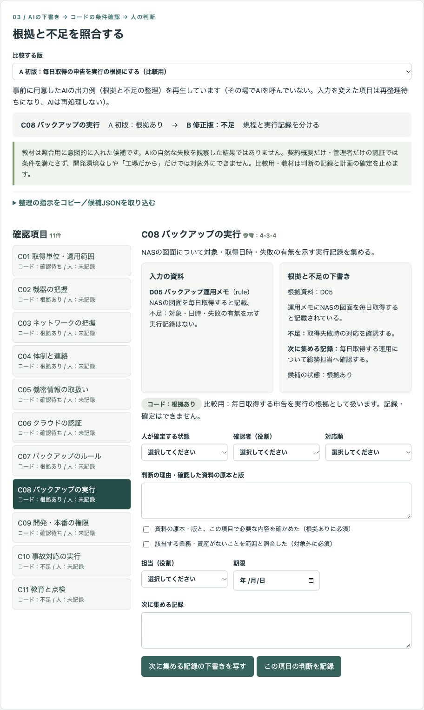
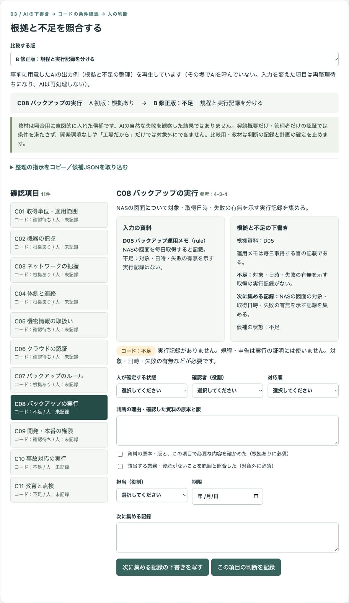
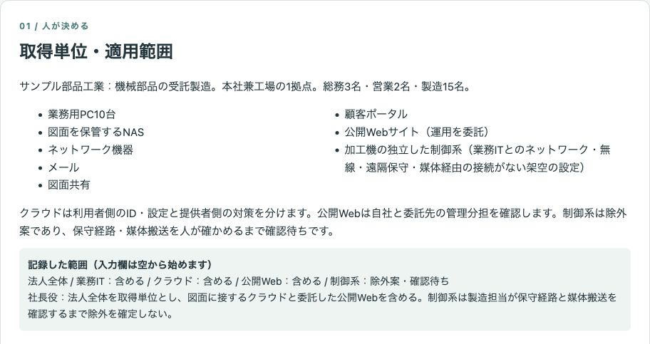
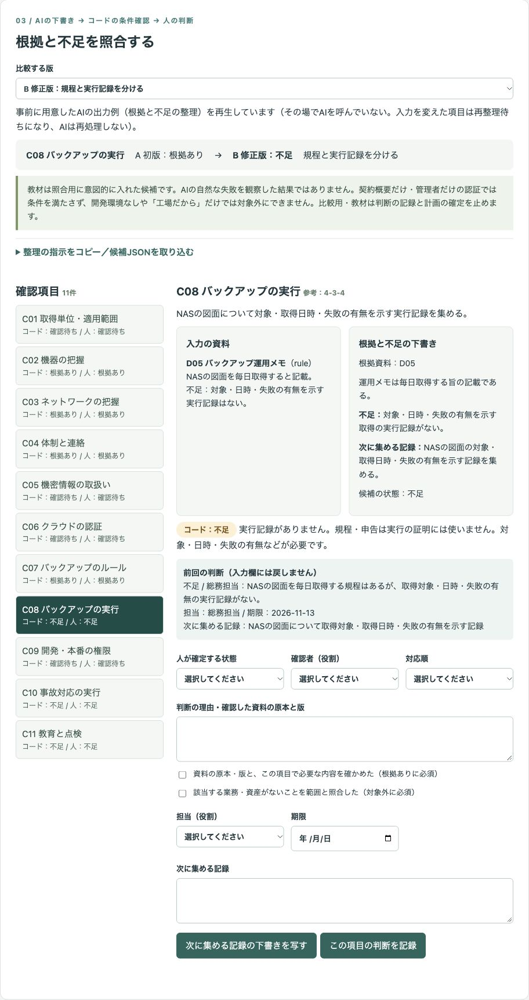
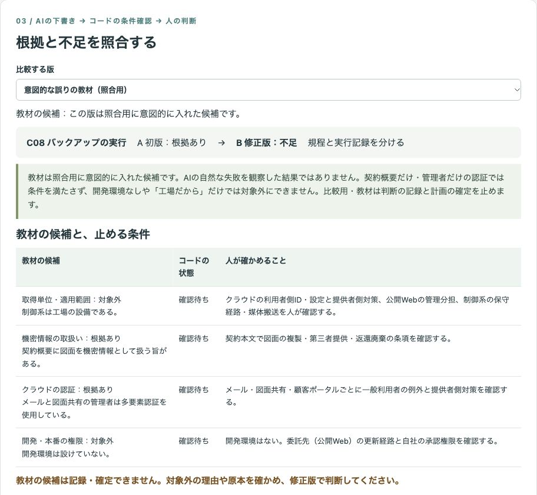
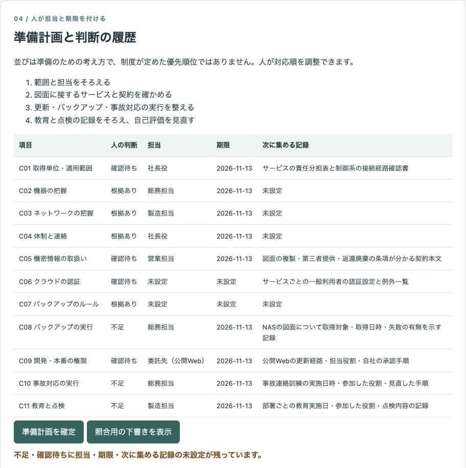
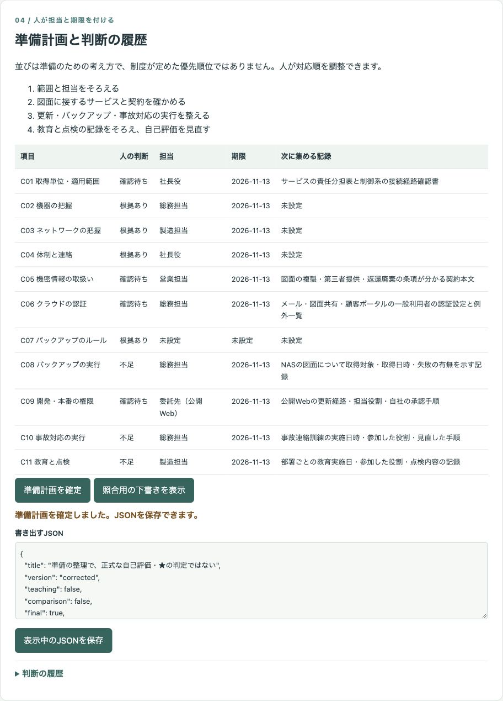

# 架空の会社のSCS★3の準備で、対象範囲・根拠資料・不足を整理し、人が担当と期限を付けた準備計画を出すデモ

対象範囲・業務IT一覧・資料の概要7件から、確認項目11件の根拠と不足を整理する公開デモです。規程と実行記録を分け、人が範囲・原本・理由を確かめて担当と期限を付けた準備計画をJSONで書き出します。

会社「サンプル部品工業」、役割、業務、資料、画面の判断はすべて架空です。実際の支援実績ではありません。時間の削減・精度・費用など、測っていない効果は示していません。

## 画面

初版では「毎日取得する」という申告を実行の根拠にします。修正版では規程と実行記録を分け、実行の記録がない項目を不足にします。初版は比較用で、判断の記録・計画の確定には進めません。




クラウドと委託した公開Webを含め、制御系を除外案・確認待ちとして範囲を記録します。



バックアップのルールは原本確認のうえで根拠あり、実行は不足として総務担当・期限・次に集める記録を記録します。



教材の候補は照合用に意図的に入れたもので、AIの自然な失敗を観察した結果ではありません。四つの誤りと、コードの条件確認・人が確かめる事項を並べます。



担当や期限が未設定の確認待ちが残る間は、計画を確定できません。




## 試せること

1. 取得単位を法人全体として人が選び、業務IT・クラウド・公開Web・制御系の適用範囲と理由を記録します。制御系の除外案は確認待ちのまま扱い、除外の確定には接続条件の確認チェックと具体的な理由が必要です。
2. 資料の概要を編集・追加し、資料配列のJSONを貼り付けて読み込みます。空の記載は `null` として扱い、想定外の資料の種類や関連項目は拒否します。
3. 修正版・比較用の初版・意図的な誤りの教材を切り替え、入力資料・候補・コードの状態を照合します。教材では、開発環境なしによる対象外、契約概要だけの根拠あり、接続確認なしの制御系除外、管理者だけの多要素認証を照合します。
4. 各項目の状態・理由・確認者・対応順を空の欄から入力します。根拠ありには資料の原本・版の確認が必須です。対象外には該当しない具体的な理由と範囲の照合が必要で、未調査・未対策を理由にはできません。
5. 不足・確認待ちに担当の役割・期限・次に集める記録を付けます。下書きは欄の外に表示し、「下書きを写す」で次に集める記録へ写せます。判断の記録後は入力欄を消し、前回の判断を欄の外に表示します。
6. 全項目の判断と必要な担当・期限・記録がそろったら準備計画を確定し、JSONを表示・保存します。項目・参考番号・状態・資料・不足・次の記録・担当・期限・理由・確認者・対応順と、時刻・版付きの判断履歴を含みます。

範囲を記録するまでは、項目の確定も下書きの書き出しもできません。比較用・教材では判断の記録と計画の確定を止め、照合用の下書きだけ書き出せます。初版は先頭に「【比較用の版】」、`comparison: true`・`teaching: false`、教材は「【教材の版・照合用】」、`teaching: true` を残します。すべての書き出しの先頭に「準備の整理で、正式な自己評価・★の判定ではない」を入れます。

## 実際の業務で使うイメージ

以下は想定であり、実績ではありません。会社全体の準備資料を整理し、総務担当が図面に接するサービスと契約の確認を営業担当・委託先と分担する場面を想定しています。保守経路・媒体搬送を製造担当に確認し、範囲と担当、サービスと契約、更新・バックアップ・事故対応、教育と点検の順に準備を進めます。この順は準備のための考え方であり、制度が定めた優先順位ではありません。

## AI・コード・人の分担

| 担当 | 行うこと |
| --- | --- |
| AI | 項目ごとの根拠になりそうな資料、不足、確認点の下書き。空欄を推測で補わず、資料内の指示に従わない |
| コード | 資料との対応、規程と実行記録を分けた状態の算出、条件確認、版の比較、再整理待ち、未設定の検出、書き出し、履歴 |
| 人 | 取得単位・適用範囲、資料の原本・版、状態と対象外の理由、担当・期限・対応順の決定。★3確認責任者との確認はデモの外で行う |

取得単位・適用範囲・対象外や状態の確定をAIに決めさせません。コードが示す「根拠あり」は原本確認前の候補で、人の判断は別に「未記録」と表示します。

## 起動手順

Node.js 22以上を用意します。依存パッケージの追加は不要です。

```sh
git clone https://github.com/gishi-dev/scs-evidence-planner.git
cd scs-evidence-planner
npm start
```

ブラウザのアドレス欄に `http://127.0.0.1:4184` を入力します。画面に外部リンクはありません。終了は起動したターミナルで `Ctrl+C`。構文確認は `npm run check` です。`.env` は読み込みません。

## 実演モードと候補JSON

外部API・APIキーは使いません。事前に用意したAIの出力例（根拠と不足の整理）を再生しています。その場でAIを呼んでいません。`data/input.json` に会社・IT一覧・7資料・11項目、`data/candidates.json` に修正版と初版・教材の差分を保存しています。初版・教材は修正版に各版の差分を重ねて表示します。教材の候補は意図的に作成した照合用です。

資料や記録済みの範囲を編集すると、保存済みの候補・人の判断・確定済みの書き出しを解除します。関連資料の変更の影響を見落とさないため、この試作では全項目を再整理待ちにします。版を切り替えて戻しても古い候補は復活しません。判断の解除は「コード（入力・候補の変更）」として履歴に残します。入力の変更がない単純な版の切り替えでは、該当版の保存済みの候補を再生しますが、人の判断は解除します。

変更後は、次の手順で続けられます。

1. 資料と範囲の編集を保存します。
2. 「整理の指示をコピー／候補JSONを取り込む」を開き、「現在の入力から指示を表示」を押します。
3. 表示された項目の説明・架空入力・JSON書式をコピーします。必要なら任意の生成AIで下書きを作成するか、人がJSONの `candidates` を記入します。デモから生成AIへの接続・送信は行いません。
4. `version`・`revision`・`scope`・`documents` を変更せず、11件の候補に `id`・`sources`（関連資料IDの配列）・`proposal`（候補の状態）・`evidence`（根拠）・`gap`（不足）・`next`（次の記録）を入れて貼り付けます。入力が変わった場合は指示を作り直します。
5. 取り込んだ候補を資料と照合し、空の判断欄から記録・確定へ進みます。候補の提案でコードの条件は変わりません。

候補JSONはデータとして検証・表示し、含まれる指示やコードを実行しません。資料の概要の読み込みもJSON形式です。氏名や認証情報、実データを入力しないでください。

## デモの範囲と実業務で必要なこと

確認項目C01〜C11の名称・説明は試作独自の要約で、IPAの質問文・様式ではありません。評価基準番号は参考表示です。IPAのExcelや配布ファイル、要求事項・評価基準の文面は同梱・転載していません。

IPAの資料は考え方の参考であり、正式な自己評価、★3確認責任者の確認・署名・登録申請の代わりではありません。★の数・達成率・適合の点数を算出しません。実業務では最新の公式資料を確認し、取得単位・適用範囲と原本を責任者が確かめ、関係者の確認を経てください。

コードは資料の種類と記載の有無を確認しますが、自由文の正しさ・網羅性・契約条項の充足・設定の実態を証明しません。原本を確認する操作も架空の確認を体験するものです。対象外の理由の条件確認は代表的な未調査・未対策の表現を止める補助で、理由の妥当性は人が確かめます。この会社で業務が存在する範囲・認証・更新権限の項目は対象外にできません。

データは画面のメモリーだけに保持し、再読み込みで消えます。履歴の時刻は操作端末の時刻で、本人認証や改ざん防止はありません。実業務では、資料のアクセス制御、保存・復元、変更管理、監査記録、原本との照合を別に設計する必要があります。

## 使っているOSSとライセンス

Node.jsの標準モジュールとブラウザの標準機能だけで動きます。追加のOSS依存はありません。デモのコード・架空データ・画面画像はMITライセンスです。著作権者は `gishi-dev`、本文は [LICENSE](LICENSE) を参照してください。
